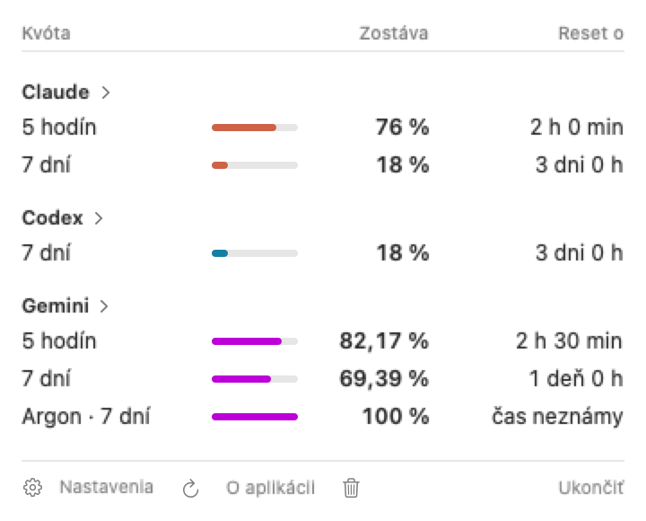

# QuotaBar

See how much Claude, Codex and Gemini quota you have left, and when each limit resets, from the macOS menu bar.


The rings show **quota used**. From the outside in, they track Claude’s 5-hour window, Codex’s 7-day window and Gemini’s 5-hour window. Click the icon to see **quota remaining** and the **time until reset** for each window.



In **Nastavenia → Sledované aplikácie**, turn on the providers you use. Both the icon and the panel adapt to your selection. Prefer vertical bars? Choose **Horná lišta → Zobrazenie → Zvislé stĺpce**.

## Install

Requires **Apple Silicon**, **macOS 14 or later** and [Homebrew](https://brew.sh). Run in Terminal:

```sh
brew tap jaromarko/quotabar https://github.com/JaroMarko/QuotaBar.git
brew trust --cask jaromarko/quotabar/quotabar
brew install --cask jaromarko/quotabar/quotabar
open /Applications/QuotaBar.app
```

The app is ad-hoc signed. macOS may ask for confirmation on first launch because the build is not notarized. If you have an older manual installation, quit it and move the old app out of Applications before installing.

**Update later:** `brew update && brew upgrade --cask quotabar`

## Connect your providers

| Provider | What you need |
| --- | --- |
| Claude | A signed-in local Claude Code session. For local measurements, run the bridge installer below, then open a new Code session. |
| Codex | Codex CLI installed and signed in with ChatGPT. |
| Gemini | Antigravity CLI (`agy`) installed and signed in. QuotaBar reads its built-in `/usage` panel while a user session is running. |

**Claude bridge** (requires the Claude CLI):

```sh
"$(brew --repo jaromarko/quotabar)/scripts/install_claude_bridge.sh"
```

Quota history stays on your Mac. QuotaBar has no analytics and does not store provider credentials.
